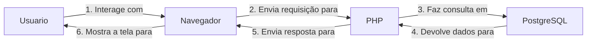

# CadernoVivo — Documentação 

**Sistema:** CadernoVivo — Papelaria  
**Tipo de documento:** Especificação de Requisitos de Software 
**Referência de estrutura:** ISO/IEC/IEEE 29148:2018  
**Versão:** 1.0 
**Data:** Setembro/Outubro de 2026  
**Tecnologias utilizadas:** PHP, PostgreSQL, HTML e CSS

---
# Sumário

# Sumário

1. [Introdução](#1-introdução)
   - 1.1. [Propósito](#11-propósito)
   - 1.2. [Escopo do produto](#12-escopo-do-produto)
   - 1.3. [Contexto e problema](#13-contexto-e-problema)
   - 1.4. [Definições e acrônimos](#14-definições-e-acrônimos)
2. [Descrição geral do sistema](#2-descrição-geral-do-sistema)
   - 2.1. [Perspectiva do produto](#21-perspectiva-do-produto)
   - 2.2. [Funções principais](#22-funções-principais)
   - 2.3. [Classes de usuários](#23-classes-de-usuários)
3. [Execução do Projeto](#9-execução-do-projeto)
   - [Pré-requisitos](#pré-requisitos)
   - [Passo a Passo](#passo-a-passo)
4. [Link do protótipo e Documentações de RN e RF] (#4-link-do-prototipo)


---

---
# 1. Introdução

## 1.1. Propósito

Este documento especifica os requisitos funcionais e não funcionais do CadernoVivo, uma aplicação web desenvolvida para funcionar como uma papelaria digital e controle de estoque para administradores. O documento descreve as funcionalidades esperadas, as regras de negócio, os dados utilizados, entre outros.

A especificação tem como objetivos:

- Padronizar o entendimento sobre o funcionamento do Cadernovivo;
- Registrar os recursos disponíveis e os limites do sistema;
- Servir como referência para desenvolvimento, testes e manutenção;
- Apoiar a identificação de falhas e a evolução do projeto;
- Relacionar requisitos, regras de negócio e critérios de aceitação.

## 1.2. Escopo do produto
O CadernoVivo é uma solução digital integrada desenvolvida para operar como a plataforma oficial da empresa. O projeto une duas frentes fundamentais do negócio em um único ecossistema web:

E-commerce (Portal do Cliente): Uma loja virtual moderna, intuitiva e acessível para que estudantes, profissionais e empresas possam catalogar, escolher e adquirir materiais escolares, de escritório e de papelaria técnica.

Sistema de Gestão e Estoque (Portal do Administrador): Um painel administrativo (backoffice) completo baseado em operações e CRUD, projetado para o controle eficiente do catálogo de produtos, rastreio de validade de itens químicos (tintas, colas, marcadores) e monitoramento de fluxo de inventário em tempo real.


## 1.3. Contexto e problema
A criação do ecossistema digital CadernoVivo surge da necessidade de solucionar gargalos operacionais e expandir o alcance de mercado da empresa:

- Unificação de Canais de Venda e Gestão: Eliminar a lacuna entre o estoque físico e as vendas online, garantindo que o cliente finalize compras de itens com disponibilidade real e atualizada.
- Automação do Controle de Reposição: Substituir processos manuais por alertas automáticos de Estoque Mínimo, impedindo a ruptura de estoque de itens de altíssima giro (como papéis A4, canetas e cadernos universais).


## 1.4. Definições e acrônimos

| Termo | Definição |
|---|---|
| CadernoVivo | Sistema web de uma papelaria digital. |
| CRUD | Sigla de *Create, Read, Update and Delete*: criar, consultar, atualizar e excluir registros. |
| DER | Diagrama Entidade-Relacionamento, utilizado para representar entidades e relacionamentos do banco de dados. |
| RF | Requisito Funcional. |
| RNF | Requisito Não Funcional. |
| RN | Regra de Negócio. |

---

# 2. Descrição geral do sistema

## 2.1. Perspectiva do produto

O CadernoVivo é uma aplicação web conectada a um banco de dados PostgreSQL. A interface permite que o usuário interaja com o sistema por meio de páginas e formulários. O PHP processa as requisições, aplica validações e regras de negócio, e realiza as operações no banco de dados.

Visão simplificada da arquitetura:


## 2.2. Funções principais

O sistema permite ao usuário (cliente):
- Criar um usuário para si mesmo;
- Realizar login e logout;
- Realize compras de produtos do site;
- Liste e Visualize produtos do Site;
- Pesquisar suas viagens cadastradas;
O sistema permite ao usuario (administrador)
- Cadastre Produtos
- Delete Produtos
- Atualize produtos
- Liste Produtos
- Crie usuarios
- Delete Usuarios
- Atualize Usuarios
- Liste Usuarios


## 2.3. Classes de usuários

| Tipo de usuário | Descrição | Permissões esperadas |
|---|---|---|
| Visitante | Pessoa que ainda não entrou em uma sessão autenticada. | Acessar telas públicas, ou seja, realizar cadastro ou login e ver produtos da vitrine. Não possui acesso a páginas privadas, como as de adicionar, visualizar ou excluir registros e comprar produtos. |
| Usuário autenticado | Pessoa que entrou no sistema com credenciais válidas. | Realizar compras e iniciar ou sair de uma sessão |
| Administradores | Pessoa que tem acesso a controle de estoque e usuarios cadastrados | Atua sobre o sistema de forma Administrativa, auxiliando na organização do site e estoque. |

---

# 3. Requisitos do sistema

## 3.1. Convenção e prioridade

Os requisitos são identificados como `RF-XXX` e `RNF-XXX`. A prioridade está classificada como:

- **Alta:** essencial ao objetivo principal ou à segurança do sistema.
- **Média:** importante para completar a experiência e a consistência do uso.
- **Baixa:** melhoria de qualidade que não impede o funcionamento básico.

---

## 3.2. Requisitos funcionais

### Cadastro e autenticação

#### RF-001 — Cadastro de usuário
**Prioridade:** Alta  
**Descrição:** o sistema deve permitir que uma pessoa crie uma conta por meio de um formulário de cadastro.

**Critérios de aceitação:**
- O nome, o e-mail e a senha devem ser solicitados conforme o formulário de cadastro;
- Os campos obrigatórios devem ser validados;
- O e-mail não deve ser aceito se já estiver cadastrado, ou seja, se já houver um cadastro com aquele mesmo e-mail;
- O sistema deve apresentar retorno de sucesso ou falha.

#### RF-002 — Validação dos dados de cadastro
**Prioridade:** Alta  
**Descrição:** o sistema deve validar os dados recebidos antes de criar uma conta.

**Critérios de aceitação:**
- Entradas obrigatórias vazias devem ser recusadas;
- Dados inválidos devem gerar mensagem de erro;

#### RF-003 — Login
**Prioridade:** Alta  
**Descrição:** o sistema deve permitir que uma pessoa cadastrada entre na plataforma com suas credenciais.

**Critérios de aceitação:**
- As credenciais informadas (e-mail e senha) devem ser verificadas no banco de dados;
- Credenciais inválidas devem ser recusadas;
- A mensagem de erro não deve revelar informações sobre a existência prévia do e-mail ou dados de outros usuários.

#### RF-004 — Proteção das páginas privadas
**Prioridade:** Alta  
**Descrição:** o sistema deve restringir o acesso às páginas internas e operações de produtos e perfil apenas a usuários autenticados.

**Critérios de aceitação:**
- O acesso às funções internas do sistema é permitido apenas para usuários que fizeram login;
- O código da aplicação deve sempre checar se o usuário está logado antes de carregar qualquer página privada (via verifica_user.php).
- Uma tentativa de acesso não autorizado deve ser bloqueada e redirecionada para a página inicial (index.php).

#### RF-005 — Logout
**Prioridade:** Alta  
**Descrição:** o sistema deve disponibilizar uma operação para encerrar a sessão do usuário.

**Critérios de aceitação:**
- O encerramento da conta (logout) deve destruir a sessão ativa do usuário no servidor de forma definitiva;
- Após o logout, o uso do botão "Voltar" do navegador não deve permitir visualizar dados das páginas privadas;
- O usuário deve ser redirecionado para a página inicial.

---

### Gerenciamento de produtos

#### RF-006 — Cadastrar produto
**Prioridade:** Alta  
**Descrição:** o sistema deve permitir que o usuário autenticado como administrador crie um novo produto

**Critérios de aceitação:**
- Disponibilizar formulário completo para preenchimento dos dados do produto (nome, preço, descrição, validade, e imagem do produto;
- Validar o nome do produto para que não seja cadastrado um identico ao site;
- Validar a descrição do produto;
- Definir obrigatoriedade nos campos a serem informados para que não falte informações ao site;
- Salvar as informações no banco de dados (PostgreSQL) associadas ao usuário autenticado;
- Exibir mensagem de retorno confirmando o sucesso ou a falha da ação.


#### RF-007 — Listar produtos
**Prioridade:** Alta  
**Descrição:** o sistema deve apresentar todos os produtos listados no banco

**Critérios de aceitação:**
- Carregar os produtos cadastrados a partir de consultas ao banco de dados;
- Exibir cada registro mostrando o nome, preço, data de validade, descrição, quantidade no estoque e imagem url ;
- Apresentar uma mensagem quando a conta não possuir produtos registrados.

#### RF-008 — Visualizar detalhes do produto
**Prioridade:** Média  
**Descrição:** o sistema deve permitir a consulta detalhada de todas as informações de um produto selecionado.

**Critérios de aceitação:**
- Exibir todos os dados do relato (nome, preço, data de validade, quantidade no estoque, e fotos);
- O botão "Voltar" da tela de detalhes deve retornar o usuário para a página exata de onde veio (inicio);

#### RF-009 — Pesquisar produtos
**Prioridade:** Alta  
**Descrição:** o sistema deve permitir que o usuário filtre um produto por meio de um campo de busca por destino (id).

**Critérios de aceitação:**
- A pesquisa deve procurar o numero id dentro do banco de dados;
- A busca deve mostrar apenas o produto selecionado previamente;
- Se nada for encontrado, o sistema deve exibir a mensagem: "Produto não encontrado";

#### RF-010 — Editar produto
**Prioridade:** Alta  
**Descrição:** o sistema deve permitir que o usuário atualize as informações e adicione novas fotos de um relato já cadastrado.

**Critérios de aceitação:**
- Ao abrir a tela de edição, os dados antigos da viagem já devem vir preenchidos nos campos;
- As novas informações digitadas devem ser checadas pelo sistema antes de salvar;
- Se a pessoa enviar novas fotos, elas devem ser adicionadas à viagem sem ultrapassar o limite total de 10 fotos;
- Validar as novas datas inseridas para impedir que o início ou o fim da viagem sejam definidos em uma data futura (maior que a data atual);
- Apenas o dono da viagem pode alterar as informações;
- As alterações devem ser salvas no banco de dados e atualizadas na tela na mesma hora.
- Validar as datas informadas para impedir que a data de término (data_fim) seja anterior à data de início (data_inicio);


#### RF-011 — Excluir produto
**Prioridade:** Alta  
**Descrição:** o sistema deve permitir que o usuário remova permanentemente produto de banco de dados.

**Critérios de aceitação:**
- O sistema só deve permitir a exclusão se a pessoa cadastrada for administradora;
- Ao apagar o produto o registro é removido do banco de dados e os arquivos das fotos são deletados;
- O produto excluído deve sumir da tela imediatamente e não aparecer mais em nenhuma opção.

---

### Perfil do usuário

#### RF-012 — Consultar perfil
**Prioridade:** Média  
**Descrição:** o sistema deve permitir que o usuário autenticado como administrador visualize as informações das contas dos clientes.

**Critérios de aceitação:**
- As informações mostradas na tela devem ser exatamente as da pessoa que está logada;
- Dados protegidos, não devem aparecer na tela.

#### RF-013 — Atualizar perfil
**Prioridade:** Alta  
**Descrição:** o sistema deve permitir que o usuário administrador altere os dados cadastrais de clientes.

**Critérios de aceitação:**
- O sistema deve checar os novos dados digitados antes de salvar as alterações;
- As alterações salvas no banco de dados devem atualizar na hora as informações da conta logada.

#### RF-014 — Excluir conta
**Prioridade:** Alta  
**Descrição:** o sistema deve permitir que o usuário administrador exclua permanentemente algum perfil da plataforma.

**Critérios de aceitação:**
- O sistema deve identificar qual conta apagar usando o id ou email;
- O sistema deve pedir uma confirmação da pessoa antes de deletar a conta;
- Ao apagar o perfil, o sistema deve fazer a exclusão completa: apagar o cadastro do usuário.
- Depois de apagar tudo, o sistema deve encerrar a sessão e mandar o usuário de volta para a tela inicial (index.php).
---

# 3. Execução do Projeto

## Pré-requisitos

- PHP instalado e configurado;
- PostgreSQL instalado e em execução;
- Navegador web.
- Git instalado na maquina

## Passo a Passo

#### Passo 01. Clonar o Repositório

- Copie a URL desse repositório
```bash
# Clone este repositório
git clone 

# Acesse a pasta do projeto
cd cadernovivo

```
---
#### Passo 2: Configurar o Banco de Dados
Juntamente aos arquivos do projeto, você tem acesso ao dump do banco de dados `cadernovivo.sql`, você usará ele neste momento. Siga as instruções abaixo:

- Abra o Terminal, Prompt de Comando ou PowerShell.
- Conecte-se ao PostgreSQL de acordo com seu sistema operacional:

    - Linux/macOS (Terminal):
    ```bash
    sudo -u postgres psql
    ```

    - Windows (Prompt/PowerShell):
    ```bash
    psql -U postgres
    ```

- Crie o banco de dados cadernovivo (- Se o banco de dados já existir e for necessário recriá-lo, você pode apagá-lo e criar um novo para evitar conflitos. Dentro do terminal interativo do psql)
```bash
CREATE DATABASE cadernovivo;
```

- Crie o usuário cadernovivo com senha:
```bash
CREATE USER cadernovivo WITH PASSWORD 'cadernovivo';
```

- Altere proprietário do database:
```bash
ALTER DATABASE cadernovivo OWNER TO cadernovivo;
```

- Verifique se tudo ocorreu bem (banco de dados e usuário criados)
    - Verificação do banco de dados:
```bash
\l
```

    - Verificação dos usuários:
```bash
\du # Lista básica

 ou

\du+ # Lista detalhada
```
- Saia do usuário postgres:
```bash
\q
```

- Estando na raiz do projeto `(pasta cadernovivo)`, restaure o banco de dados executando o seguinte comando:
```bash
psql -U cadernovivo -d cadernovivo -f cadernovivo.sql
```

- Configure as permissões da pasta de uploads:
    - Para que o servidor web consiga gravar as imagens enviadas pelos usuários na pasta `/uploads`, é necessário conceder permissões no sistema operacional do servidor. Então, digite:
```bash
  chmod -R 777 cadernovivo/uploads
```
> Consideração de Segurança: O uso do comando `chmod 777` concede permissões totais de leitura, escrita e execução para todos os usuários. Embora essa abordagem resolva de forma simples e imediata os bloqueios de envio de arquivos durante os testes no servidor local, não é a prática recomendada para ambientes de produção real, pois expõe o diretório a riscos de segurança (como a execução não autorizada de scripts).

#### Passo 3: Configurar a Conexão no PHP
1 - Na pasta database, abra o arquivo connect.php.

2 - Altere as credenciais para corresponderem às do seu ambiente local PostgreSQL:

```bash
$host = 'localhost';
$port = '5432';
$dbname = 'cadernovivo';
$user = 'cadernovivo';
$password = '123456';

```

#### Passo 4: Acessar a Aplicação
- Após configurar o banco de dados e a conexão, inicialize o servidor. Com o seu terminal aberto na pasta raiz do projeto, execute o comando abaixo:
```bash
php -S 0.0.0.0:8000
```
- Deste modo, o projeto estará acessível no seu navegador através do endereço `http://localhost:8000`.
- Agora você está pronto para explorar a aplicação!


---
# 4. Link para documentação de protótipo e RFS E RNS:
```bash
https://docs.google.com/document/d/171XYA-p7-CGgV4lwFjLFimNJqnHw9xMukEXUeOl64VE/edit?usp=sharing
```

**Fim da documentação. Obrigada pela atenção!**
